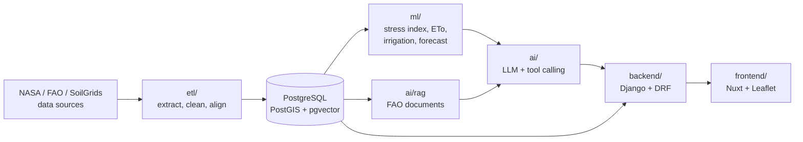

# Field Shift

**Adapting agriculture with NASA Earth observation data.**

Field Shift is an AI-assisted farm advisory system built for the **NASA Hackathon 2026 (Agri-Space Mission)**. It ingests NASA satellite and weather data for a pilot field in Egypt, computes water-stress and irrigation numbers with deterministic agronomic models, and uses an LLM to explain those numbers to the farmer as clear, prioritised advice.

> **Design rule:** the LLM never invents numbers. Every figure shown to a farmer comes from a tested function in `ml/`; the LLM only selects tools, retrieves agronomy guidance, and writes the explanation.

---

## Table of contents

- [Scope](#scope)
- [How it works](#how-it-works)
- [Tech stack](#tech-stack)
- [Repository layout](#repository-layout)
- [Quick start (Windows + WSL2)](#quick-start-windows--wsl2)
- [Configuration](#configuration)
- [Everyday commands](#everyday-commands)
- [API](#api)
- [Data sources](#data-sources)
- [AI and ML design](#ai-and-ml-design)
- [Testing and CI](#testing-and-ci)
- [Contributing](#contributing)
- [Project timeline](#project-timeline)
- [Troubleshooting](#troubleshooting)
- [Documentation](#documentation)
- [License](#license)

---

## Scope

The project is deliberately narrow. A working end-to-end demo beats a broad system that doesn't run.

| Item | Decision |
|---|---|
| Pilot region | Nile Delta, Egypt *(proposed; confirm in `docs/decisions/`)* |
| Crops | Wheat and maize *(proposed; confirm in `docs/decisions/`)* |
| Test field | One field polygon *(to be defined)* |
| Budget | **Zero.** Every tool and service used must be free. |

## How it works



1. **ETL** pulls weather, soil moisture, vegetation and precipitation data for the pilot field and loads cleaned, daily-aligned tables into PostgreSQL.
2. **ML** functions compute NDVI anomaly, soil-moisture deficit, FAO-56 reference evapotranspiration (ETo), irrigation need, and a 7-day soil-moisture trend.
3. **AI** receives a farmer's question and priority (Yield vs. Cost), calls the ML tools for numbers, retrieves relevant FAO guidance, and returns structured advice.
4. **Backend** exposes everything through a REST API with a generated OpenAPI contract.
5. **Frontend** shows a field map, a chat panel, a Yield/Cost toggle, and decision cards.

## Tech stack

| Layer | Choice |
|---|---|
| Language / tooling | Python 3.12, [uv](https://docs.astral.sh/uv/), ruff, pytest, pre-commit |
| Database | PostgreSQL + PostGIS + pgvector |
| Backend | Django, Django REST Framework, GeoDjango, drf-spectacular |
| ETL | pandas, xarray, rasterio, geopandas, earthaccess |
| ML | numpy, pandas, statsmodels (rule-based models plus a light forecast) |
| AI | OpenAI-compatible client with native tool calling; local models via Ollama; local embeddings |
| Frontend | Nuxt, Tailwind CSS, Leaflet, Pinia, pnpm |
| Infrastructure | Docker Compose, GitHub Actions |

ETL, ML and AI are plain Python packages imported by the backend. There are no separate services to deploy.

## Repository layout

```
field-shift/
|-- .github/                CI workflow and PR template
|-- backend/                Django project (config/, apps/{fields,climate,crops,advice})
|-- etl/                    extractors/, transforms/, tests/
|-- ml/                     eto.py, stress.py, irrigation.py, forecast.py, notebooks/, tests/
|-- ai/                     advisor.py, tools.py, providers/, rag/, prompts/, knowledge/, tests/
|-- frontend/               Nuxt app
|-- db/                     Postgres image (PostGIS + pgvector) and init SQL
|-- data/                   Local data cache (gitignored): raw/, cache/, samples/
|-- docs/                   api/ (OpenAPI contract), decisions/ (short ADRs)
|-- docker-compose.yml
|-- Makefile
|-- pyproject.toml          The only Python project file
`-- uv.lock
```

**Dependency rule:** `backend` may import `etl`, `ml` and `ai`. `etl` and `ml` must never import Django.

## Quick start (Windows + WSL2)

These steps assume Windows. On Linux or macOS, skip step 1 and use your normal shell.

### 1. Prerequisites

- **WSL2 with Ubuntu:** in an admin PowerShell run `wsl --install`, then reboot.
- **Docker Desktop** with the WSL2 backend, and WSL Integration enabled for your Ubuntu distro.
- Inside Ubuntu:

  ```bash
  sudo apt update && sudo apt install -y git make curl
  curl -LsSf https://astral.sh/uv/install.sh | sh
  # install Node 22 LTS (via fnm or nvm), then:
  corepack enable
  corepack prepare pnpm@latest --activate
  ```

> **Important:** clone and work inside the WSL filesystem (for example `~/projects/field-shift`), **not** under `/mnt/c/...`. Bind mounts and file watching are far faster and more reliable there.

### 2. Clone and configure

```bash
git clone git@github.com:<org>/field-shift.git
cd field-shift
cp .env.example .env
```

Edit `.env`: set real values for the secrets, and set `DEV_UID` and `DEV_GID` to the output of `id -u` and `id -g`. See [Configuration](#configuration).

### 3. Create the local Python environment

```bash
uv sync
uv run pre-commit install
```

This creates `./.venv` in the repo root. Use it for your editor, linting, Jupyter and the ETL/ML/AI tests. In VS Code (WSL extension), select `./.venv/bin/python` as the interpreter.

### 4. Install frontend dependencies

```bash
cd frontend && pnpm install && cd ..
```

### 5. Start the stack

```bash
make up                # or: docker compose up -d --build
docker compose exec backend python manage.py migrate
```

### 6. Verify

| Check | Expected |
|---|---|
| `docker compose exec db psql -U fieldshift -d fieldshift -c "\dx"` | Lists `postgis` and `vector` |
| <http://localhost:8000/api/docs/> | Swagger UI |
| <http://localhost:8000/api/schema/> | OpenAPI schema |
| <http://localhost:3000> | Nuxt frontend |

If all four pass, your environment is ready.

## Configuration

All configuration lives in `.env` (copied from `.env.example`). Never commit `.env`.

| Variable | Purpose |
|---|---|
| `POSTGRES_DB`, `POSTGRES_USER`, `POSTGRES_PASSWORD` | Database credentials |
| `DB_HOST`, `DB_PORT` | Database address (`db` / `5432` inside Compose) |
| `DEV_UID`, `DEV_GID` | Your WSL user and group IDs, so files created in containers are owned by you |
| `DJANGO_SECRET_KEY`, `DJANGO_DEBUG`, `DJANGO_ALLOWED_HOSTS` | Django settings |
| `CORS_ALLOWED_ORIGINS` | Frontend origin allowed to call the API |
| `EARTHDATA_USERNAME`, `EARTHDATA_PASSWORD` | NASA Earthdata login (free account required) |
| `LLM_PROVIDER` | `mock` (default) or `openai_compat` |
| `LLM_BASE_URL`, `LLM_MODEL` | Endpoint and model for the `openai_compat` provider |
| `NUXT_PUBLIC_API_BASE` | Backend URL used by the frontend |

### Using a local LLM (optional)

The default `LLM_PROVIDER=mock` returns fixed responses and needs nothing installed. To use a real model for free, run [Ollama](https://ollama.com) on the Windows host, pull a model that supports tool calling, then set:

```
LLM_PROVIDER=openai_compat
LLM_BASE_URL=http://host.docker.internal:11434/v1
LLM_MODEL=<your model name>
```

If the container gets "connection refused", Ollama is probably bound to loopback only. Set `OLLAMA_HOST`, restart Ollama, and scope a Windows Firewall rule to your private network.

## Everyday commands

| Task | Command |
|---|---|
| Start / stop the stack | `make up` / `make down` |
| Django management commands | `docker compose exec backend python manage.py <command>` |
| Create migrations | `docker compose exec backend python manage.py makemigrations` |
| ETL / ML / AI tests | `make test` |
| Backend tests | `make test-backend` |
| Lint and format check | `make lint` |
| Regenerate frontend API types | `make api` (backend must be running) |
| Add a Python dependency | `uv add <package>`, then `docker compose build backend` |
| Add a frontend dependency | `cd frontend && pnpm add <package>` |
| Reset the database | `docker compose down -v` (**deletes all data**) |

Once GeoDjango is enabled, run Django commands inside the container, not on the host, because they need GDAL.

## API

The API contract is generated from the code with drf-spectacular and exported to `docs/api/openapi.yaml`. The frontend generates its TypeScript types from it, so a contract change breaks the build instead of breaking the demo.

| Endpoint | Purpose |
|---|---|
| `POST /advice` | Get structured advice for a field, a question and a priority (Yield or Cost) |
| `GET /field/{id}/summary` | Current field status: indices, soil moisture, stress, forecast |
| `GET /api/schema/` | OpenAPI schema |
| `GET /api/docs/` | Swagger UI |

The advice response follows the shared schema: `summary`, `actions[]` (each with priority, timing and reason), and `alerts[]`.

## Data sources

| Domain | Source | Used for |
|---|---|---|
| Weather and solar | NASA POWER | Temperature, radiation, humidity, wind, precipitation (daily) |
| Soil moisture | SMAP | Surface and root-zone moisture, drought and water stress |
| Vegetation | MODIS / HLS (via NASA Earthdata or AppEEARS) | NDVI and EVI time series |
| Precipitation | GPM IMERG | Water balance |
| Soil profile | SoilGrids | NPK, pH, organic matter baseline |
| Crop parameters | FAO guidance | Crop coefficients (Kc), growth stages, nutrient needs |

NASA Earthdata access needs a free account. Cache a historical sample for the pilot field in `data/samples/` so the demo works offline. Raw data stays out of git.

## AI and ML design

**ML (`ml/`)**
- Pure, typed Python functions with unit tests (FAO-56 worked examples as reference values).
- Rule-based water stress from NDVI anomaly, soil-moisture deficit and ETo.
- A lightweight 7-day soil-moisture trend forecast.

**AI (`ai/`)**
- A tool-calling loop: the LLM calls tools such as `get_field_summary`, `calc_irrigation_need`, `calc_stress_index` and `search_agronomy_docs`, and writes the final answer from their results.
- RAG over FAO manuals and regional extension guides, stored as embeddings in pgvector.
- Output is validated against the response schema with Pydantic, with one retry and then a safe fallback.
- A number check verifies that figures in the answer appear in the tool results.
- Every call is recorded in `advice_log` (inputs, tool calls, outputs).
- Providers are swappable (`ai/providers/`): `mock` for development and CI, `openai_compat` for Ollama or any compatible API.

## Testing and CI

Tests are split because loading Django models requires GDAL, which exists in the backend container but not on a plain CI runner.

```bash
uv run pytest etl ml ai                    # host, no Django needed
docker compose exec backend pytest backend # container, with PostGIS
```

GitHub Actions runs on every pull request:

- **python:** `uv sync --frozen`, `ruff check`, `ruff format --check`, `pytest etl ml ai`
- **frontend:** `pnpm install --frozen-lockfile` and `pnpm build`

CI never calls a real LLM; it uses the `mock` provider.

## Contributing

- Work on a feature branch and open a pull request into `main`. **Direct pushes to `main` are not allowed.**
- Every PR needs **at least one approval** and passing CI.
- **Definition of Done:** code is merged into `main`, covered by unit tests, documented in `docs/`, and demonstrable in the UI.
- Use `uv add` and `pnpm add` so lockfiles stay in sync, and commit both lockfiles.
- Never commit secrets, `.env`, or raw datasets.
- Keep `ml/` and `etl/` free of Django imports.

**Team rhythm**
- Daily 15-minute standup at the start of the day.
- Daily report by **5:00 PM**: completed yesterday (linked to a commit or PR), plan for today, blockers, and one observed risk.

## Project timeline

| Days | Milestone | Exit criteria |
|---|---|---|
| 1-2 | Foundations | Repo configured, pilot region and crops locked, JSON API contracts agreed, DB schema approved, NASA Earthdata access verified |
| 3-5 | Vertical slice v0 | One test field end to end: ETL, DB, API, mock AI, UI dashboard |
| 6-7 | Real data and logic | All three datasets live, ML models active, FAO documents indexed in pgvector |
| 8 | Feature freeze | Full pipeline verified on the pilot field without errors |
| 9 | Hardening and evaluation | Edge cases, AI answer verification, error states, fallback responses |
| 10 | Demo and submission | Pitch deck, rehearsed live demo, backup video, `docs/` complete |

The Day 5 vertical slice is non-negotiable: connecting even a mock AI response to the frontend early exposes interface mismatches while there is still time to fix them.

## Troubleshooting

| Symptom | Likely cause and fix |
|---|---|
| Odd errors from shell scripts or Dockerfiles in containers | CRLF line endings. Make sure `.gitattributes` is committed, then re-clone. |
| Slow builds or file changes not picked up | The repo is under `/mnt/c`. Move it into the WSL filesystem. |
| `docker` not found in WSL | Enable WSL Integration for your distro in Docker Desktop settings. |
| Port 5432 already in use | A local Postgres is running. Stop it or change the host port in Compose. |
| Database extensions missing | The init scripts ran on an old volume. Run `docker compose down -v` and start again. |
| Files in the repo owned by root | Set `DEV_UID` and `DEV_GID` in `.env`, then run `sudo chown -R $USER:$USER .` |
| `manage.py` fails on the host with a GDAL/GEOS error | Expected once GeoDjango is enabled. Run Django commands in the container. |
| Ollama connection refused from a container | See [Using a local LLM](#using-a-local-llm-optional). |
| Frontend CI cannot find the pnpm version | Add the `packageManager` field to `frontend/package.json`. |

## Documentation

- `docs/api/openapi.yaml`: exported API contract
- `docs/decisions/`: short decision records (pilot region, crops, stack choices)
- `docs/`: data dictionary (variable, unit, resolution, update frequency), architecture notes and runbook

## License

*To be decided.* Add a `LICENSE` file before the public release or submission.

## Acknowledgements

Data and guidance from NASA (POWER, SMAP, MODIS/HLS, GPM IMERG, Earthdata), ISRIC SoilGrids, and the FAO. Built for the NASA Hackathon 2026.